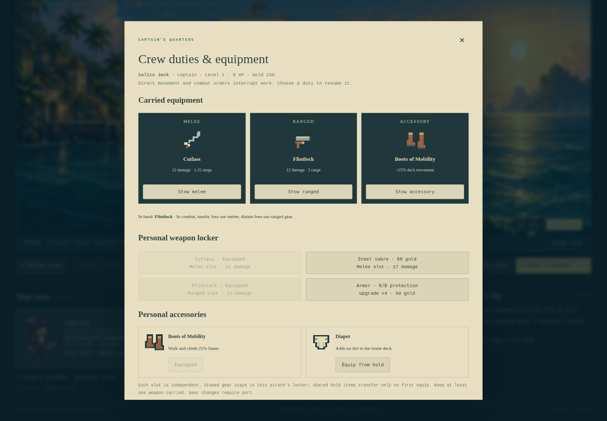
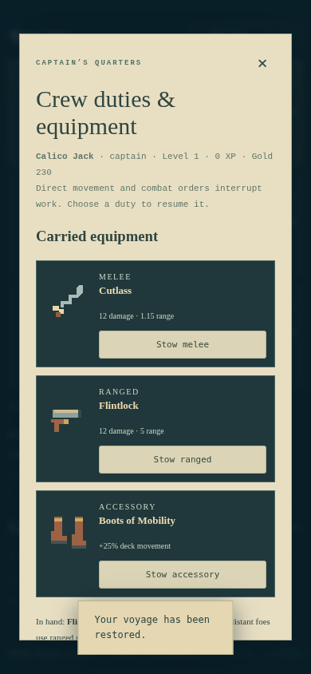

# Carried weapons and accessories

Version 0.12.0 implementation contract, 2026-10-11. The parity target is the current Steam release. The [505 Games manual](https://dlassets-ssl.xboxlive.com/public/content/e5a27a6c-f320-4b3f-8751-42ff7ea5f4b0/GameManual/d9df5d6f-349d-4104-a19d-6c83c0fdc8d3/en-US/index.html) identifies separate melee, ranged and accessory equipment. Older [community equipment guidance](https://pixelpiracy.fandom.com/wiki/Getting_Started) and the [2014 Steam guide](https://steamcommunity.com/sharedfiles/filedetails/?id=208987734) corroborate those categories and describe Boots of Mobility and Diaper. This is category evidence, not verification of the current Steam build's formulas or AI.

## Ownership and controls

Each pirate carries one optional melee weapon, one optional flintlock and one optional accessory. At least one weapon must remain carried. Personal lockers retain purchased or recovered gear; stowing is free and does not duplicate it into shared stock. A recovered item transfers to one pirate when first equipped. Re-equipping personally owned gear leaves unrelated shared stock intact. Only living allies in port can change gear. All port changes use the existing atomic save barrier and restore loadouts, personal ownership, hold stock and gold together on failure.

The active in-hand weapon remains a plain enum used by the existing independent equipment/finger layers and portraits. No second simultaneous hand sprite or baked-in weapon is introduced. Separate carried-slot cards identify melee, ranged and accessory contents and offer stowing; gear buttons identify equipped, personally owned, recovered or purchased states.

## Combat and passives

At an attack boundary, nearby targets select a carried melee weapon; more distant targets select a carried ranged weapon, if available. The last attack's weapon remains active through its shared cooldown to preserve its existing pose and prevent cooldown-reset attacks. Stowing ranged gear leaves melee pursuit; stowing melee gear leaves pistol fighting. Independent per-weapon reload timers, ammunition for handguns, accuracy/crit/knockback, and the full weapon catalogue remain gaps. Current range/damage/cooldown values are original browser balance.

Actual intact hull cells block a chest-height ranged segment; ladders, destroyed cells and decorative rear cabin walls do not. This is a bounded plain-geometry scan with no physics world or persistent ray cache.

Boots of Mobility cost 65 gold and increase deck/ladder path speed by 25%, multiplied with the existing Swift trait. They do not change sea exposure, rope traversal or rescue speed. Diaper costs 40 gold and prevents that wearer contributing dirt to the home deck. Every hundred active voyage ticks, each living supported home pirate without Diaper contributes one dirt, up to the existing 100 cap. Dead pirates and actors aboard another vessel, falling or at sea do not dirty the home ship. These rates/prices and the adapted dirt model are authored balance. Accessory effects derive from the equipped enum each time; repeated equip/stow never stacks modifiers.

Shared stock extends from six to eight fixed 0–99 counters. A danger-two-or-higher prize may replace one consumable with an accessory, retaining the four-item cap and the ship's recovered weapon guarantee. The local seed does not advance combat RNG. No duplicate rewards arise on cleared revisits.

## Save migration and lifetime

Schema 8 serializes both slots, active weapon, accessory and at most two unique owned accessories. Reject unknown/wrong-slot/unowned gear, a fully empty weapon loadout, an active weapon outside the carried slots, duplicate accessory ownership and malformed stock. Schema 1–7 migrates immutably. Existing six-kind stock and campaign maps survive; new accessory stock/lockers start empty. A legacy pistol occupies only the ranged slot, and a legacy blade only the melee slot; loading does not silently equip the other owned weapon or grant an accessory.

The campaign owns plain enums/arrays, bounded by three known weapons and two known accessories. Existing simulation movement/combat and existing delegated application input own effects/controls. No new timers, Phaser textures, sprites, subscriptions, workers, caches or background world objects are required. Scene shutdown/application disposal follow existing owners. Meaningful unit/browser checks must cover actual weapon switching, blocked shots, stowing, ownership, passives, malformed imports, legacy migration, save failure, reload and repeated equip/disposal before publication.

## Inspected build and focused verification

The desktop view puts all three slots before weapon/accessory locker choices and the duty roster. Phone slots stack as compact icon/text rows without page overflow at 390 pixels. Slot names/details/labels measure minimum contrast 8.19:1. The compact capture includes the existing save-restored toast over the footer; it does not demonstrate complete notice/focus/touch accessibility. No new crew or weapon atlas was required.

186 unit scenarios pass, including nineteen new equipment scenarios. A dedicated browser run exercises real market purchases, equip/stow, recovered ownership, four injected equipment-write failures, 150 accessory changes, personal-locker independence, save reload, a schema-seven file import through visible controls, an actual ranged-to-melee attack transition, body/item/grip facing in both directions, ten scene restarts and final disposal. Ten textures/four scene subscriptions remain stable, with zero retained source images. [Focused report](../equipment-validation-results.json).

Actual combat captures: [ranged attack](../images/equipment-ranged.webp), [blade attack](../images/equipment-melee.webp). Combat setup fixes target position/HP through the diagnostic fixture; simulation ticks and actual cooldowns drive the weapon change. This proves handling/selection and cleanup in that fixture, not original AI equivalence or a complete original combat catalogue.

First accessories and carried categories are delivered. Unarmed fighting, transferable gear instances, independent melee/ranged reloads, handgun ammunition, crit/accuracy/knockback, full weapons/passives and exact current-Steam formulas remain unimplemented or unmeasured.

The isolated full integration/lifecycle run passes with frame p95 41.67 ms, simulation p95 0.1 ms and zero stalls in Chromium SwiftShader. Across fifty rendered encounters, diagnostic-GC JS heap changes from 10,469,776 to 9,741,012 bytes; event listeners remain 75 and global textures ten. Full gameplay, management, save rollback, exclusive writer, artwork failure/reload, context loss, audio and disposal checks pass. [Measured report](../validation-results.json). These observations are not hardware 60-FPS evidence, a 30-minute ordinary-GC soak or GPU heap-snapshot inspection.

The full sample precedes the final camera-button refresh guard. Parallel fleet regression exposed an intermittent stale “Other vessel” highlight after capture: the scene could choose home after the UI had rendered the same frozen simulation revision. UI invalidation now observes the camera-mode scalar as well as revision, using the existing periodic render callback. A focused regression forces that frame ordering and checks that the highlight updates without changing authoritative revision. No timer/subscription/view owner is added. Final focused fleet and production checks cover the correction.

[Additional regression results](../loadout-regression-results.json) record item/world trips, swimming/rescue, furnishing/refit, cabins/destruction, fleet headroom/capture/camera and production root/project-path checks. The final fleet run verifies 26-pixel minimum native-frame cabin headroom for seventeen actors, both directions and panned input. Focused samples are not an isolated frame-rate benchmark.
