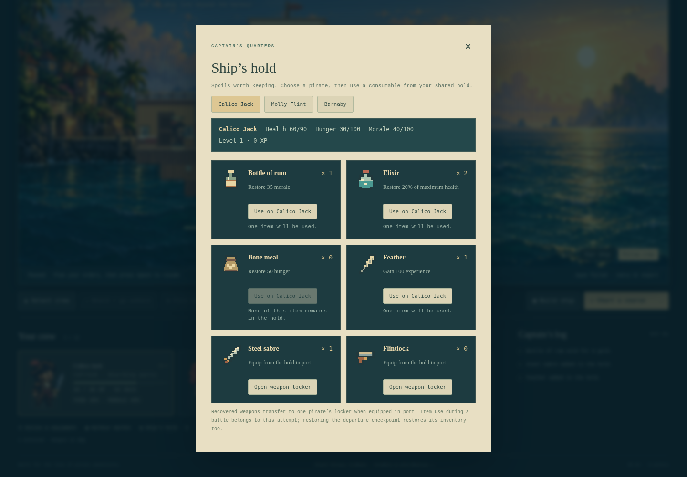
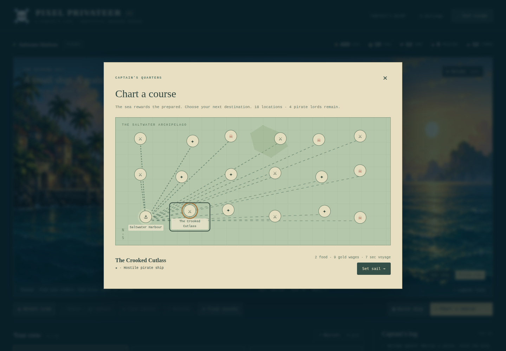
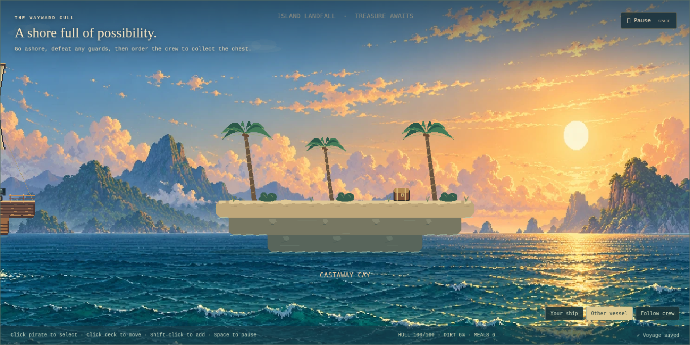

# An owned hold and a different voyage

Version 0.11.0 contract and runtime review, 2026-10-11. The user selected the **current Steam release** as the parity target. This addition closes a first portion of inventory/drop and seeded-region gaps; it does not establish full original-game parity.

The [505 Games manual](https://dlassets-ssl.xboxlive.com/public/content/e5a27a6c-f320-4b3f-8751-42ff7ea5f4b0/GameManual/d9df5d6f-349d-4104-a19d-6c83c0fdc8d3/en-US/index.html) describes crew consumable use, gear and character progression. It documents a console version, so it establishes system categories rather than exact current-PC rules. Community [item descriptions](https://pixelpiracy.fandom.com/wiki/Items) and [Elixir](https://pixelpiracy.fandom.com/wiki/Elixir) search excerpts disagree on fixed versus percentage healing; direct pages failed retrieval. Their names/categories informed this small catalogue. Prices, normalized needs, loot selection and map-generation rules below are original browser balance. No sprites, texts or source were extracted from Steam.

## Owned items

The shared hold has six fixed integer counters, each capped at 99. New and migrated campaigns begin with an empty hold; starting personal weapon lockers remain unchanged. Rum restores 35 morale, Elixir restores 20% of maximum HP rounded up, Bone meal restores 50 hunger, and Feather grants 100 XP. Needs/HP clamp to their maxima. Experience crosses every earned threshold, bounded by level 100 and existing stat caps; applying a feather at level 100 does not consume it.

Steel sabres and flintlocks are recovered weapon stock. Equipping a weapon not already owned transfers one matching hold item to that pirate's locker before charging gold. Equipping an already owned weapon keeps unrelated hold stock. Other crew lockers remain independent. Current single-weapon loadouts and port-only changes remain; simultaneous melee/ranged/accessory slots are a remaining gap.

Port purchase/sale/use/equip is an atomic save transaction. Rejected full-stock, insufficient-gold, unknown-item, dead/enemy/overboard/transit, full-stat and max-level requests spend nothing. Sales require owned stock and reject a full gold reserve. Required write failure restores the previous stock, gold and crew effects. Battle/aftermath use is allowed while paused and belongs to the current attempt; recovery restores its departure checkpoint. No unsafe combat checkpoint is written.

A prize contains at most four items, selected from its persisted seed without consuming authoritative combat RNG. Higher-danger ships include one recovered weapon in that total. The aftermath ribbon previews items before plunder/capture; either action claims the same owned items exactly once. Full stacks convert only the excess to half-price gold, with explicit journal feedback. Treasury overflow uses the existing stated cap warning. Cleared revisits grant no fresh items.

The inspected hold shows the selected pirate's health/hunger/morale/level and six original pixel icons. Each consumable identifies its recipient and disabled reason. Names and stats have measured minimum contrast 6.59:1 against their dark panels. Inspection caught and corrected inherited dark text before delivery. The close button has a 32-pixel target. UI uses the existing delegated listener; icons are DOM SVG rectangles, not Phaser textures.

## Seeded region

Generator version 1 creates eighteen plain node records on a jittered six-column/three-row chart: one resupply harbour, seven pirate ships, six islands and four pirate lords. The affordable danger-one ship and unguarded island retain IDs 1/2, with distinct nearby slots. The four lords retain their existing IDs/danger rules. Remaining locations vary seeds, positions and danger; encounter geometry is instantiated only at arrival. All displayed destinations remain directly reachable through the existing abstract travel rules. A seed reproduces the same complete chart for this generator version; combat RNG starts untouched.

Generation takes a fixed number of draws and at most eighteen slot removals. There is no rejection/retry loop, former-map cache, background worker or persistent generated encounter. A new-voyage seed accepts whole numbers 1 through 4,294,967,295; leaving it empty generates another chart. Whole maps and clear flags persist in checkpoints, so legacy ten-node maps remain intact and never regenerate on load. Island widths vary between eighteen and twenty-six cells; every rail, guard spawn and chest remains connected. Palm placement follows the actual shore width.

The chart hides unselected labels to avoid name collisions, exposes labels on hover/focus/selection, marks the selected destination and presents its hazard/supply/wage/duration preview. Keyboard selection uses native buttons and pressed states. Paths originate at the current location. Old travel duration/economy remains unchanged; map distance does not yet affect travel time. The grid remains recognizable across seeds; this is a controlled region generator, not a reproduction of original topology, discovery, multiple regions, towns or quests.

Compact captures: [hold](../images/items-phone.webp), [chart](../images/world-phone.webp).

## Verification and limits

167 scenarios pass. Added tests cover 1000 item seeds, 1000 map seeds, 512 island layouts, stock overflow, non-waste use, recovered ownership, multi-level XP caps, exactly-once capture/plunder, malformed item imports and immutable old-save/map migration. Browser checks exercise visible trades/use/equip/reload, injected purchase/sale/use quota failures, fifty hold-panel cycles, ten scene restarts and disposal. The map harness validates seed input, seed-42 reload, keyboard route selection, an actual island boarding/chest/return/prize trip and cleared revisit/reload. Compact checks establish no horizontal overflow at 390 pixels, not comfortable touch use or complete accessibility. [Item results](../items-validation-results.json), [world results](../world-validation-results.json).

The isolated full integration stress sample records frame p95 40.00 ms and simulation p95 0.1 ms, with zero stalls in Chromium SwiftShader. Across fifty rendered encounters, diagnostic-GC JS heap changes from 10,404,820 to 9,661,112 bytes; listeners remain 75, textures ten and scene subscriptions four. A concurrent-browser sample was substantially slower (frame p95 113.33 ms, 29 stalls); it motivated the isolated repeat. The full sample precedes the final dead-recipient equip guard and return-route drawing fix, both covered by the final focused/unit/production checks. These are scoped software-rendering observations, not 60-FPS hardware evidence or an ordinary-GC soak. [Full results](../validation-results.json).

This is a six-item starter catalogue. Full consumables, equipment/accessories, weapon levels, skill ranks, crew attributes/squads, wildlife/pets, town residents, quests, difficulty modes and the original content catalogue remain. Only one region and existing enemy/guard AI are implemented. Current Steam release is the chosen target, but its installed build and exact formula/content coverage have not been measured. Keep the remaining gaps explicit until those comparisons exist.
