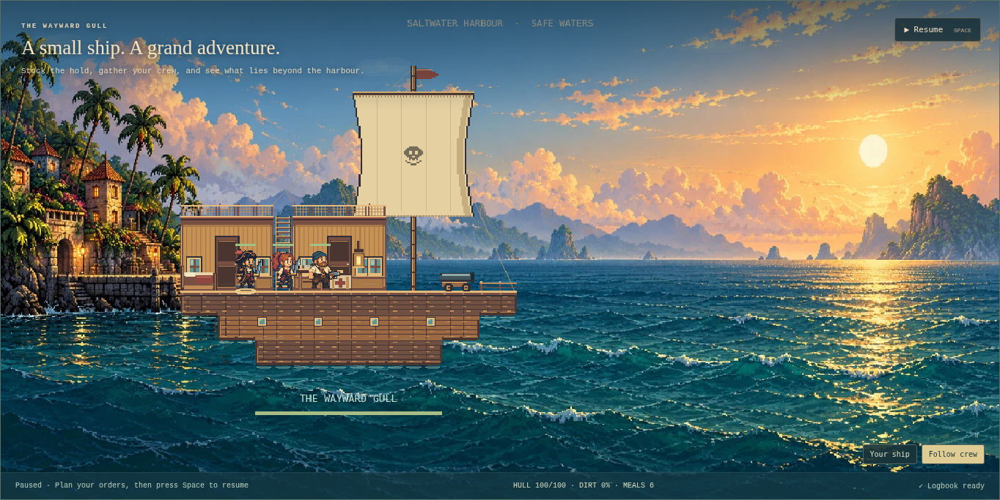
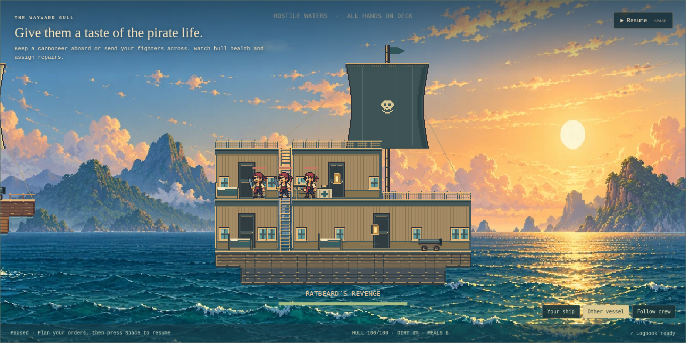
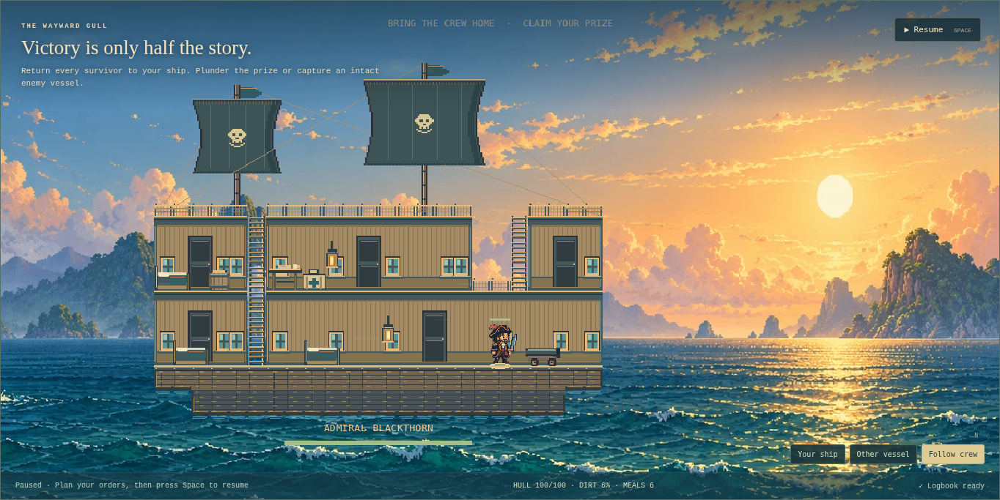

# Roomier ships and bidirectional crew

Version 0.10.2 implementation contract, 2026-10-11.

Increase horizontal cells from 18 to 24 pixels and vertical cells from 26 to 32 pixels. Three-cell cabins become 96 pixels tall, leaving 26 pixels above the unchanged 56-pixel crew frame after the 14-pixel cornice. Increase door/window/fitting proportions to suit the larger rooms. Preserve saved geometry, inventories and simulation rules.

Keep the 1280-pixel viewport width and native crew scale. Increase its height to 640, and pan horizontally between Your ship, Other vessel and Follow crew views. Camera focus is presentation state; no save migration, texture copies, tween timers or additional event subscriptions. Fix the background/HUD to the viewport, transform canvas clicks through the camera, keep whole-pixel scroll and expose keyboard-operable view controls. Very large custom hulls may extend outside one view; following a selected crewmate provides navigation through their rooms.

Facing must respond to horizontal movement or a living target. Vertical movement alone must preserve direction; new enemies initially face toward the home vessel. Body, equipment and fingers share the same facing. Verify actual left/right movement, stopped direction, vertical travel, melee/ranged targets, and scene restart/teardown ownership. No crew shrinking or baked-in weapons.

Capture roomier starter/brig interiors and both facing directions. Re-run ceiling clearance, actual movement/capture/save, panned canvas selection/movement and builder input, bounded camera focus and lifecycle/performance checks. Record observed limits and measured results after visual inspection.

## Runtime review

The inspected browser captures show the starter's larger doors and furniture behind unchanged crew, and two full-height brig/flagship room levels. Horizontal ship width is 33% larger, with no camera zoom or atlas resampling. The enlarged lower cabin leaves clear space above the hat and enough width between fittings. Standing clearance checks cover 17 cabin occupants, minimum 26 pixels above the entire native 56-pixel frame. Saved layouts retain their tile coordinates.

[Left-facing crew after a real climb](../images/roomier-facing-left.webp). Actual horizontal movement checks both directions; 21 vertical movement samples preserve left facing. Separate renderer fixtures check cutlass, sabre and pistol toward targets on either side, including matching equipment and foreground fingers. New enemies face left on arrival. These fixtures verify handling rather than natural-play combat balance.

The visible camera controls switch to a whole enemy ship and follow selected crew; panned canvas clicks select the allied pirate in the hold and issue a successful deck move. Camera zoom remains one, scroll uses integer pixels, and scene restart/disposal releases existing owners. No extra texture, timer, global listener or persistent geometry cache is added. Ship centers/bounds are calculated only when static scenery changes; per-frame follow scans at most the bounded crew list.

## Validation and limits

145 unit scenarios pass. Focused fleet, ship/refit, swimming/rescue and furniture/save browsers pass, along with production build, formatting and root/project-path hosting. Ten fleet scene restarts retain three matching body/item/grip owners, ten shared textures and four scene subscriptions. Source-image owners return to zero; final disposal removes canvas, actors, layers, subscriptions and navigation graphs. [Roomier machine-readable report](../roomier-validation-results.json).

One hundred forced static redraws measure scene-update CPU p95 0.80 ms, maximum 1.30 ms in Chromium/SwiftShader at 1440 × 1000. An earlier concurrent run measured p95 2.70 ms/max 21.80 ms, showing shared-machine contention. These samples exclude GPU completion and is not a real-device frame-rate promise. Ordinary frames reuse static ship graphics.

The fixed canvas still scales targets small at 390 pixels. The view buttons prevent large enemy ships being clipped, but touch zoom, vertical panning of unusually deep custom hulls, interactive doors and construction rules for very low ceilings remain future work. Very large custom hulls may span more than one camera view. The existing aftermath banner can obscure scene details. No original-game proportions or complete parity are claimed.

The full browser suite also passes 100 panel cycles, ten restarts, fifty rendered encounters and storage/artwork/context failure checks. Frame p95 is 36.66 ms, tick p95 0.10 ms with zero stalls in the scoped sample; diagnostic-GC JS heap changes from 10,166,228 to 9,541,836 bytes and event listeners stay at 75. This is a software-renderer sample, not an ordinary-GC or hardware soak. The full suite uses early cutter encounters; the focused fleet harness exercises larger hulls. [Full report](../validation-results.json).
