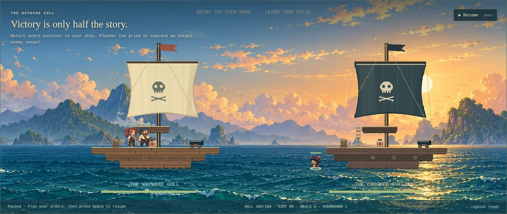
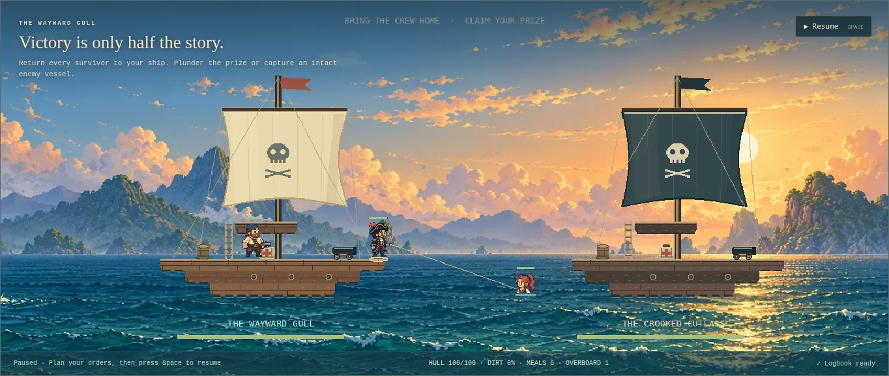

# Boarding, swimming and sea rescue

Version 0.9.0, 2026-10-11. Replaces instant boarding transfers and immediate overboard death with deterministic timed traversal and recoverable sea hazards. Mechanics and balance below are authored interpretations; exact reference-game formulas have not been measured.

## Crossing between vessels

A boarding/retreat order first reaches a supported rail. A crossing lasts forty simulation ticks (two seconds at 20 Hz) and moves continuously between valid endpoints along a slightly sagging rope. Starts are staggered by at least six ticks, and opposite directions wait for the current group to clear. At most one pirate lands in a tick. This preserves the group boarding cadence without instant transfers or a long single-file delay that strands the first fighter alone.

Both endpoints are checked during travel. Loss of the destination returns the pirate to a surviving origin rail with an explicit failure message. Loss of origin support releases the crossing and drops the pirate from its current position into the sea. New commands cannot teleport a pirate out of a crossing. Encounter rewards, escape and sailing require every surviving ally to be safely aboard on reachable support.

The implementation has a fixed authored vessel separation of 32 cells, matching the scene. It interpolates a rope path; it does not simulate rope tension, buoyancy, or rigid ship motion. Very large custom hulls and physically accurate swimming around hull collision remain fidelity gaps.

## Water and recovery

When no lower deck survives, a pirate falls toward the water surface instead of dying immediately. Swimming is a passive learned skill, bought in port for sixty gold without replacing the assigned duty. Trained pirates swim toward a safe rail and climb aboard. Untrained pirates tread water until rescued or lost.

An overboard pirate loses eight health each twenty water ticks; a trained swimmer or pirate on a rescue line loses one. Sea exposure is capped at 240 ticks. Walking/swimming/rescue/climbing speeds and this cap are authored safety/balance values, not the original game's rules. Missing safe landings are cached against the destination graph revision; restoration can make a landing available without continuously retrying failed path searches.

The Rescue overboard control appears while someone is in the water. Select a living crewmate aboard the home ship; they walk to a reachable rail and haul the line. One rescuer owns each line. The rescuer faces the actual water position, extends a bare hand and puts their weapon away. Moving or killing the rescuer interrupts the line and releases its claim; another crewmate can resume. Swimmers, crossing pirates and overboard actors cannot fight or perform station work. They do not eat or receive remote medical treatment in the sea.

The renderer crops submerged legs, draws a water ripple and derives the rope/line from simulation state. Weapons/finger equipment layers are hidden during sea traversal and restored after safe landing, using the same existing sprite objects. The hauling hand uses the existing extended-arm/finger frame. Pause freezes authoritative sea movement; reduced motion suppresses optional bobbing.

## Saves, bounds and ownership

Schema 5 adds the Swimming skill to the bounded learned-skill catalogue. Schema 1–4 checkpoints migrate without mutating their input, preserving the existing map, traits, hull wear, loadouts and skills. Sea movement is encounter/runtime state and is not added to the checkpoint format. The application refuses saves while a sea owner remains; ordinary validation still rejects unsupported positions and unsafe phases.

Port rest can recover damaged or overboard crew before saving. Failed storage restores the original campaign plus bounded sea/fall snapshots, including exposure time, health, position and line ownership; it does not grant free recovery or reset drowning time.

The simulation owns one map with at most twelve allied and twelve enemy sea records. Records contain numeric coordinates, tick/progress values and actor/ship IDs. No renderer reference, timer, asynchronous callback, per-frame texture or particle pool is stored. Death, encounter cleanup, gameover, port recovery and simulation disposal release owners. Scene restart preserves simulation movement while rebuilding the existing views. Texture count remains ten; the sprite count and atlas sizes remain unchanged from 0.8.1.

## Verification and next gaps

111 simulation/storage/lifecycle tests include timed/group boarding, broken endpoints, rescues, interruption, exposure death, passive training, schema migration, quota rollback, fifty repeated fall/swim/rest cycles and recovery of all twelve trained allies with bounded landings. The prepared-crew full campaign test still passes. Naval target/operator tests reject overboard actors.

The dedicated browser harness checks visible training/reload, rope movement and pause, submerged cropping/stowed items, the rescue control and line, scene restart during rescue, item/crop restoration, prize checkpoints and failed port-recovery writes. The existing expedition/management/context/audio/encounter stress harness and root/project-path production hosting checks also apply. Its dedicated sea fixture accelerates ticks and does not establish real-device performance; use the main measured report for the scoped software-rendering sample.

Still deferred: swimming around hull collision, ship buoyancy/sinking animation, actual rope physics, explicit rescue targets/squads, abandoning crew, a complete original skill/stat catalogue, and cross-browser/hardware profiling. Next feature-parity work should address inventory/item drops and varied procedural regions while retaining these movement/save contracts.
