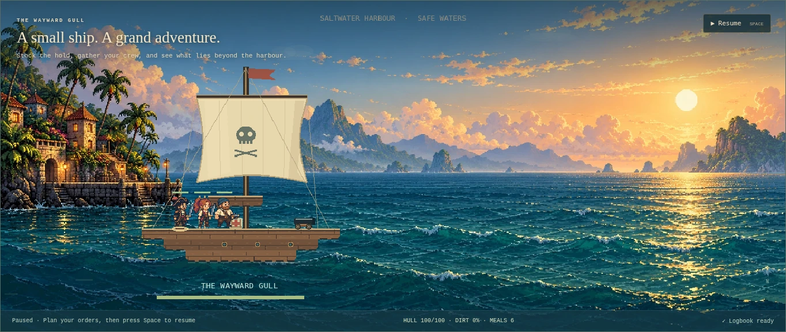
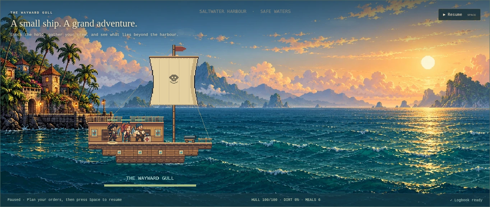
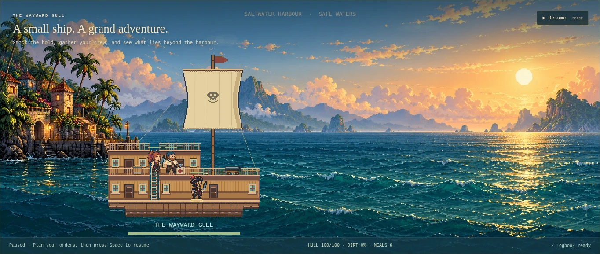
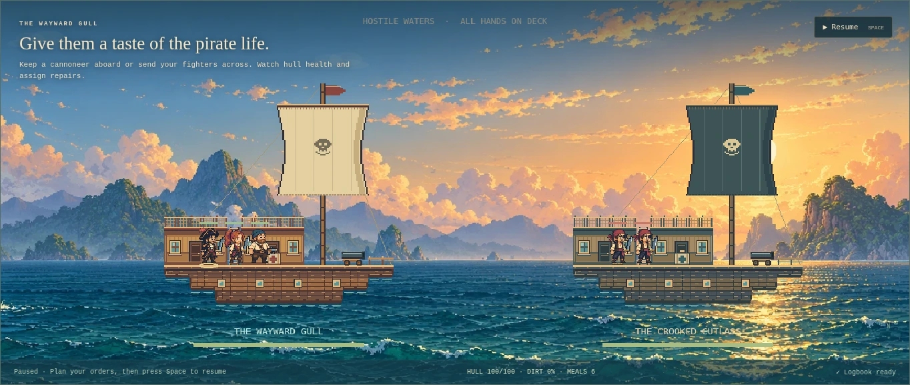

# Pixel ship cabins and construction

Version 0.9.1, 2026-10-11. Visual improvement of the existing playable game. The Product Design review used the local Chromium/Playwright harness; no plugin cloud browser is exposed here. This is a scoped visual and interaction review, not an accessibility certification or verified original-game parity.

## Reference and observed problem

The reviewed [Pixel Piracy customization screenshot](https://thegemsbok.com/art-reviews-and-articles/mid-week-mission-pixel-piracy-quadro-delta/) shows stacked cabin walls, panelled timber, alternating doors/windows, roof railings, thick horizontal deck beams and exterior ladders. These are directly visible observations from the screenshot, not measurements of the current Steam build. The screenshot was studied locally, not shipped as game artwork or redistributed in this repository.

The fresh before capture below showed the existing ship as a shallow open raft with a single unsupported-looking upper platform and a large smooth sail. It lacked cabin walls or a clear interior. Hull and sail detail did not use the same hard pixel contours as the crew.

## Runtime steps and findings

1. **Starter harbour — improved.** Two real cabin roofs now sit above the starter deck, with an exterior ladder between them. Original panelled rear walls, brass-framed windows, doors, wainscoting, cornices and carved roof rails make the crew read as occupants of a vessel. Smaller stepped cloth, seams, raster skull/flag, planked hull, chamfered lower corners and portholes replace the earlier smooth construction. The foreground retains the existing illustrated backdrop and character sprites.

2. **Refit and damage — consistent.** Remove a roof with the Hull brush and its cabin wall disappears in the preview; cancel leaves the campaign unchanged. Apply uses the real timber transaction and survives reload. Room artwork fills only consecutive columns with a surviving ceiling and lower floor, with at least a three-cell vertical gap. It splits at missing roof/support columns rather than drawing a solid decorative bridge across them. A damaged runtime roof disappears; the builder shows its intended blueprint geometry. Windows and doors are rear-wall decoration, not additional collision surfaces.

3. **Two-level ship — functional, still original art.** A larger valid refit has two stacked cabin levels. The browser fixture funds its real timber cost, then commands the captain through the exterior ladder to the lower room. Ship labels and health bars move below the deeper keel. Both roof sections on the starter vessel are also reached using ordinary movement commands.

4. **Battle and compact screen — distinguishable with limits.** Friendly cabins use warm timber/red trim and cream cloth; hostile ships use darker timber/teal trim and dark cloth. Crew, doors and weapons remain visible in front of the cutaway wall. The 390-pixel layout has no horizontal overflow; the scaled canvas and small deck targets still need a dedicated mobile camera/touch treatment. Detailed wall art alone does not improve keyboard or screen-reader game navigation.

[Current compact capture](../images/ship-cabins-phone.webp).

## Geometry, saves and ownership

`src/game/ship-art.ts` owns pure presentation functions. `cabinSpans` derives roof/floor spans from the bounded 64 × 24 tile grid. Walls/railings/doors do not become authoritative parts or consume RNG. The roofs are ordinary editable hull cells; the starter blueprint adds five aft roof cells, retaining the existing ladder/stations and normal connected-layout validation. Existing checkpoints keep their original hull and gain the new rendering automatically; no layout is silently expanded on load. Players can add a roof over an existing deck using Hull in the builder. Schema remains 5.

The scene supplies its existing static Graphics object to the integer rectangle painter. All hulls, seams, rigging, ladders and props use integer pixels, with no newly generated textures, sprites, timers, particles or retained room cache. Static commands redraw on the existing layout/draft/station/phase invalidation path. Temporary typed-grid and span data end with that redraw; scene shutdown clears the existing Graphics owner. Texture count remains ten, with the same body/item/grip objects and four scene subscriptions. Damaged-cell cracks and sea movement remain on the existing dynamic overlay.

## Verification and limits

The ship browser harness covers real roof/lower-room movement, builder cancel/apply/reload, destroyed roofs, ten scene restarts, compact layout and asynchronous Phaser disposal. Its accelerated ticks establish behavior, not performance. The unit/navigation/storage suite, full browser lifecycle stress, production build and root/project-path hosting checks also apply. [Ship-specific results](../ship-validation-results.json) and [main measured sample](../validation-results.json) record the final checks.

Still deferred: an individually purchased furnishings/wall/sail catalogue, interactive doors, richer interior furniture, varied enemy blueprints, original sprites/palette, dynamic hull physics and a camera that frames very large custom vessels. The cabin reconstruction is an original modular interpretation of the reference's structure, not an exact asset copy.
