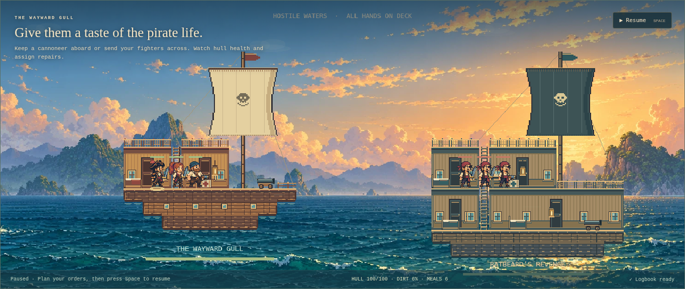
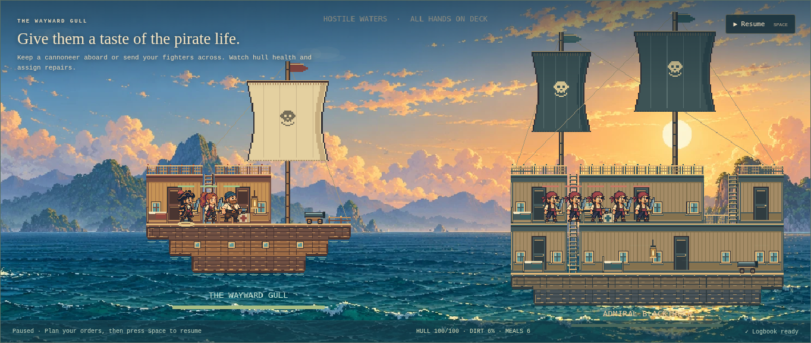
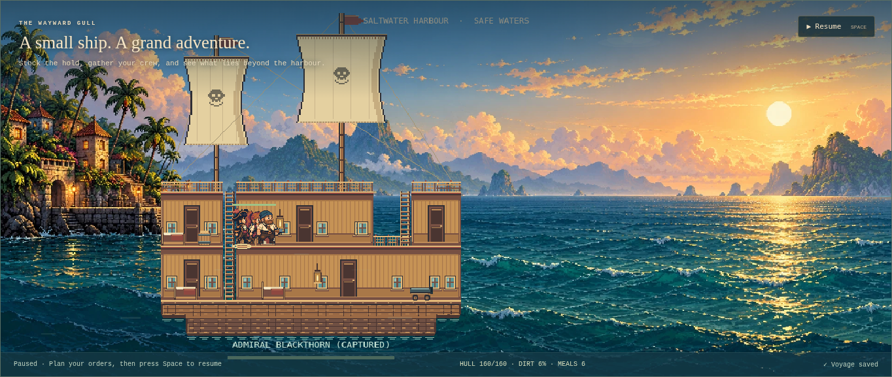
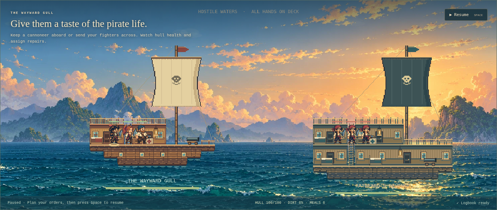
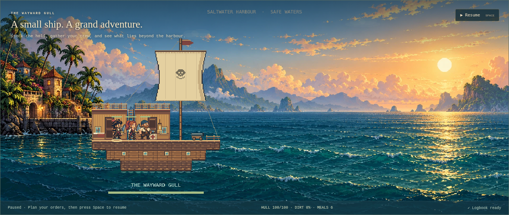

# A fleet with usable cabins

Version 0.10.1 design contract and runtime review, 2026-10-11.

The existing cutter now has readable rooms, but every encounter repeats its silhouette. Extend the original modular pixel architecture with three authored enemy templates: a longer single-deck sloop, a two-deck brig, and a broad flagship with a raised forecastle and two masts. These are original interpretations of the stacked cutaway cabins observed in the reference screenshot linked in [the ship review](ship-cabins.md), not measured original-game ship blueprints.

## Geometry and encounters

The affordable danger-one encounter retains its existing cutter and three fittings. Higher-danger pirate encounters select a sloop or brig from the saved world-node seed; danger-three/four bosses use a flagship. Template choice consumes no campaign RNG and constructs only the arriving vessel. Width stays below the 32-cell inter-ship separation; depth is at most eight hull rows. Every room floor, roof and ladder is an ordinary editable structural tile. All enemy spawn cells, stations, roof sections and lower cabins must belong to the same reachable navigation component. No fake decorative decks.

The brig/flagship hold has extra owned bunks and a lantern, so existing plunder and capture rules apply. The flagship's raised forecastle is narrower than the hull and does not displace the boarding landing. Captured templates use the friendly palette automatically and persist as existing plain ship records. Preserve old ships and checkpoints; no save schema change or automatic enlargement.

## Presentation and ownership

Intermediate floors draw beams without rooftop railings inside occupied rooms. Wide rooms receive repeated windows around the central door. Two-masted silhouettes derive from wide, deep geometry, so captured/refitted ships retain suitable rigging without template metadata. Ship art uses the current static integer Graphics painter. No new sprite, atlas, texture, timer, persistent room cache or render-side RNG.

## Acceptance

Validate hundreds of seeded layouts, station/furniture support and crew spawns. Exercise actual boarding, lower-deck movement, retreat, capture and checkpoint reload. Capture fresh runtime sloop, brig and flagship views, then inspect them at native desktop size and a narrow viewport. Repeat scene restart/disposal checks and the existing ship/refit and full campaign suites. Performance statements must cite a measured run; more rectangle commands are not assumed to be free. Broad original ship-part coverage, interactive doors, procedural regions and a large-vessel camera remain separate gaps.

## Reviewed flow

1. **Encounter silhouettes — improved.** Fresh native-size captures show a longer sloop, a brig with an inhabited hold, and a two-masted flagship with another ladder to its forecastle. Repeated windows break up long panelled walls. Intermediate floors no longer place rooftop rails inside upper rooms. Dark enemy trim remains distinct from friendly timber.

[Single-level sloop](../images/fleet-sloop.webp).

2. **Boarding and hold movement — functional.** The focused harness uses real travel, timed rope boarding, the hold ladder and retreat. It defeats fixture enemies to isolate movement; it does not establish natural-play balance. The unit suite separately completes the prepared four-boss combat campaign.

3. **Capture and reload — preserved.** Visible Capture ship and Save voyage controls retain all six fittings, floors, ladders and the lower-deck cannon. The real return trip to harbour then permits a movement order to that cannon. Victory intentionally freezes commands.

4. **Compact view and lifetime — bounded, with limits.** No horizontal overflow at 390 pixels, but the fixed scene scales ship targets too small for comfortable touch use. The aftermath/victory banner can obscure a hold. Camera/touch and banner placement remain gaps. These captures do not establish keyboard/screen-reader game accessibility or original-game fidelity. [Phone capture](../images/fleet-phone.webp).

Visual inspection caught stale artwork when campaign replacement supplied a different hull at the same location/phase/revision. Static invalidation now checks the two current ship identities. Those references clear on shutdown; no former-campaign or geometry cache accumulates.

## Verification

143 tests pass, including 512 seeded combinations with every standing node connected, supported stations/fittings/spawns, actual brig/flagship hold movement, capture/checkpoint independence and bounded integer painting. Focused browser checks pass boarding, capture/save/reload, harbour cannon access, ten restarts, compact overflow and delayed disposal without page errors. [Results](../fleet-validation-results.json).

One hundred forced static redraws of a captured flagship measure scene-update CPU p95 **1.40 ms**, maximum **4.50 ms**, in Chromium/SwiftShader at 1440 × 1000. This excludes GPU completion and is not a frame-rate or hardware guarantee. Ordinary ticks still avoid static redraws. Ten textures, four subscriptions and matching body/item/grip counts remain stable; decoded-source count returns to zero. Existing ship/refit, production build, formatting and root/project-path hosting checks pass. Broader hardware/browser and ordinary-GC soak evidence remains outstanding.

The final full browser run also passes its expedition, storage-failure rollback, artwork failure, context loss, 100 panel cycles, ten restarts, fifty rendered cutter encounter cycles and application teardown. Its measured software-renderer sample has frame p95 33.32 ms, tick p95 0.10 ms, zero stalls, and diagnostic-GC heap 10,049,340 → 9,488,876 bytes; listeners stay 75 and textures ten. These stress encounters use the retained early cutter, while the focused fleet harness covers the new largest geometry. [Full report](../validation-results.json).

## Ceiling-clearance correction

The earlier review missed that three 18-pixel cells offered only 54 pixels before the cornice, less than the 56-pixel crew frame. Hats touched or crossed the ceiling. This was a visual defect, not an accepted proportion.

The final render grid keeps 18-pixel horizontal spacing and uses 26-pixel vertical spacing: the same three-cell room is 78 pixels tall. Its 14-pixel ceiling/cornice and the unchanged 56-pixel actor leave at least eight pixels of clear space above the complete frame. Both cabin levels, starter rooms, sails, ladders, fittings, damage overlays, ropes, rescue lines, islands, builder grid and pointer conversion use the matching vertical projection. Existing saved geometry and crew sizes are retained. The origin moves upward to keep deep hulls and health labels inside the existing canvas. Doors are now 58 pixels tall where room height allows, proportioned to the crew.

A bounded beam scan caps decorative jump height only while crossing a damaged floor gap, retaining the same head clearance under roofs; open-deck jumps retain their arc. The focused browser harness checks actual native-size sprite bounds against ceiling bottoms in starter/enemy upper cabins and a boarded hold. It fails if the crew is shrunk or a hat has less than eight pixels of space. Unit checks cover every authored cabin and roofed/open/destroyed-ceiling jump clearance. This proves the checked standing frames and geometries; very low custom ceilings still need separate construction rules.

Final clearances: the browser checks 18 cabin occupants with minimum eight pixels above their entire native 56-pixel sprite bounds. Ten restarts and final disposal still pass after the vertical-scale correction. The forced-redraw p95 1.40 ms/max 4.50 ms sample ran alongside other browser checks on shared software-renderer resources.

