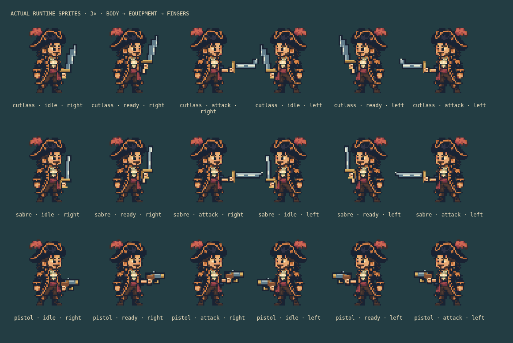
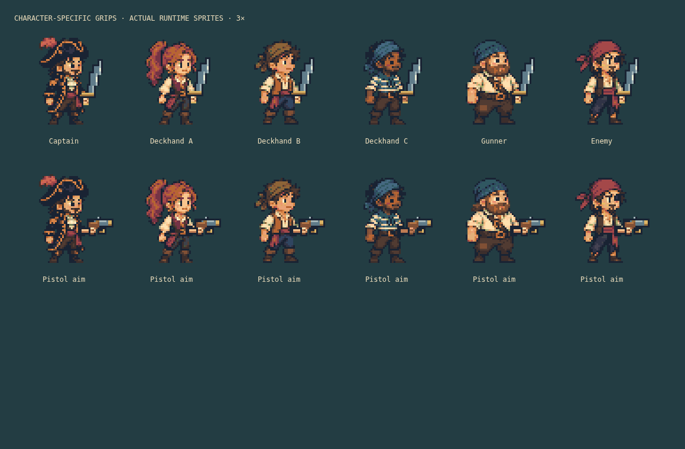

# Weapon handling and visible grips

Version 0.8.1, 2026-10-11. Preserves the accepted faces, costumes and source illustration while improving the connection between arms, hands and equipped items. Every character remains unarmed in the source art; equipment still follows the actual loadout.

## Drawing and placement

Each living actor now renders three ordered sprites: body, equipment, foreground fingers. The fingers retain the character's skin tone, add small knuckle highlights and leave a transparent opening through which the equipment grip shows. They do not contain a blade or barrel. Roster portraits use the same shared images and layer order.

[Hand metadata](../../src/game/weapon-handling.ts) defines native grip centres for all six designs and five handling poses. Equipment is authored around the captain's grip, and the renderer applies the difference to each character. A 40-pixel body and 96-pixel item frame have different centred origins; the reference grip points account for their 28-pixel difference. Facing mirrors the body, equipment, fingers and character offset together. The walking frame moves the item and fingers with the body’s one-pixel bob, without an independent timer.

Sword preparation bends the forearm upward; the strike extends it. Pistols use dedicated aim and fire body frames: aiming raises the barrel, firing draws the hand back one pixel and up one pixel. The muzzle mark derives from the actual equipment position and mirrored barrel tip, including character offsets. Existing combat cooldown/status select these frames; pause holds them still, reduced motion suppresses pose changes and muzzle marks, and port state suppresses stale combat animation. Damage, reach, cooldown, commands and saves are unchanged.

The vertical blade sits closer to the handle centre; sword guards leave the hand visible, and the pistol trigger guard forms a connected loop. Original integer raster adaptations remain distinct from any reference-game asset.

## Resources and ownership

Four body atlases grow from 200 × 168 to 280 × 168, with twenty-one frames each: seven poses across three appearance variants. The unchanged 288 × 168 equipment atlas contains nine frames. One new 280 × 336 foreground-hand atlas contains forty-two frames: seven poses across six designs. Combined decoded body/equipment/hand RGBA storage is 1,322,496 bytes (about 1.26 MiB), an increase of 577.5 KiB over 0.8.0 before driver overhead. Global texture count is ten.

Each living actor owns one hand sprite in addition to its existing body/item sprites. The existing twelve-allies/twelve-enemies cap bounds each map to twenty-four. Death, entity removal, scene shutdown and application disposal explicitly destroy and clear hand views. Shared atlases remain application-owned; scene activation binds the portrait CSS properties and shutdown removes them. Frame names and pose metadata are allocated once. No per-frame textures, animation timers, tweens, particles, new simulation fields or save migration are introduced. The full original image remains a temporary CPU-only source and is released after conversion or required-art failure.

## Verification and limits

Reviewed actual runtime sprite matrices for all six characters, all three weapons, left/right poses, and desktop/phone portraits. Browser assertions check hard alpha, atlas dimensions, frame counts, exact weapon/finger registration through carry/walk/preparation/strike, layer order, dynamic loadouts, pause, reduced motion, artwork failure/reload, scene/encounter cycles, context recovery and final disposal. See [implementation status](../implementation-status.md) and [recorded diagnostics](../validation-results.json) for measured results.

This is a limited pose set rather than continuous skeletal animation. Reload, hurt and death animation are deferred; the pistol’s next preparation pose represents readiness without a new reload mechanic. No faithful reproduction of third-party sprites is claimed.
